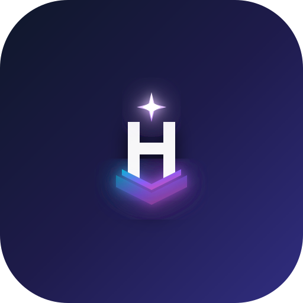
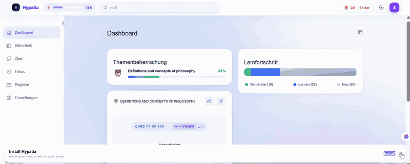
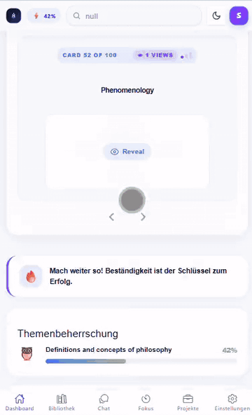

<div align="center">



# Hypatia

### Your study desk, offline and in your pocket.

Flashcards, an AI tutor that runs entirely on your device, a focus timer and Kanban projects,<br/>
shipped as a PWA and as an Android app with a native home-screen widget, and no backend at all.

<br/>


[**Demo**](#-demo) · [**Features**](#-features) · [**Under the hood**](#%EF%B8%8F-under-the-hood) · [**Structure**](#%EF%B8%8F-project-structure) · [**Contact**](#-contact)

</div>

<br/>

> [!NOTE]
> This is a **showcase repository** with a demo video and notes on the architecture.
> The full source code is private, and **access is available on request**: see [Contact](#-contact).

<br/>

## 🎬 Demo

<p align="center"></p>

<p align="center"><sub>The GIF is compressed. A <b>full-quality video</b> (1916×768, 30 fps) is in <a href="media/demo.mp4"><code>media/demo.mp4</code></a>.</sub></p>

<p align="center"></p>

<p align="center"><sub>The same app on a phone. Full-quality video: <a href="media/demo-mobile.mp4"><code>media/demo-mobile.mp4</code></a>.</sub></p>

## ✨ Features

<table>
  <tr>
    <td width="50%" valign="top">
      <h4>🃏 Flashcards</h4>
      Topic decks with per-card progress, a daily streak and quick practice from the dashboard. Cards can hold words in several languages, and Android users can send any card to the system translator.
    </td>
    <td width="50%" valign="top">
      <h4>🤖 AI tutor</h4>
      A streaming chat with markdown and collapsible "thought process" blocks for reasoning models, plus AI-generated decks that drop straight into the library.
    </td>
  </tr>
  <tr>
    <td valign="top">
      <h4>🔒 On-device AI</h4>
      The AI runs <b>in the browser on WebGPU</b>, with no cloud service and no API key. Pick a model in Settings or switch between downloaded ones in the chat. Models download once, show their progress, and can be deleted from the cache.
    </td>
    <td valign="top">
      <h4>📱 Native Android widget</h4>
      A home-screen widget that shows a card from your library. Cards you look at while the app is closed still count toward your progress and streak.
    </td>
  </tr>
  <tr>
    <td valign="top">
      <h4>⏱️ Focus timer</h4>
      A Pomodoro timer with focus, short-break and long-break modes, a task list with per-task pomodoro counts, notes, a daily goal and a session log.
    </td>
    <td valign="top">
      <h4>📋 Kanban projects</h4>
      Drag-and-drop boards for study projects, with a progress widget and a board preview on the dashboard.
    </td>
  </tr>
  <tr>
    <td valign="top">
      <h4>📴 Offline first</h4>
      Installable PWA with a service worker. Your library lives in IndexedDB on the device, and there is no account. Your data never leaves the device, not even for the AI.
    </td>
    <td valign="top">
      <h4>💾 Backup and seed decks</h4>
      JSON export and import, validated before anything is replaced. Ships with 400 ready-made cards (philosophy and front-end interview prep), and app updates can add new cards without touching your edits.
    </td>
  </tr>
  <tr>
    <td valign="top">
      <h4>🌐 English and German</h4>
      The full UI in both languages, switchable at runtime. Light and dark themes.
    </td>
    <td valign="top">
      <h4>🧩 Your own dashboard</h4>
      Rearrange the dashboard widgets by drag and drop, and tune the library, focus and AI settings, all saved on the device.
    </td>
  </tr>
</table>

## ⚙️ Under the hood

<div align="center">

| 100% | 3 | 0 | 2 | 22 |
| :---: | :---: | :---: | :---: | :---: |
| on-device AI inference | storage layers, each for a reason | backend servers or cloud APIs | platforms from one codebase | unit tests |

</div>

### Engineering decisions

| Challenge | Solution |
| --- | --- |
| Chat and card generation need one AI interface | One service exposes `askAI` (one-shot) and `chatAIStream`, an **async generator** that streams tokens from the WebGPU engine into the chat page |
| Study data and prompts should stay private | **All inference runs on the device**: there is no cloud engine and no API key, so no prompt or card ever leaves it. Settings left over from older versions, including a stored API key, are deleted on startup |
| A local LLM is gigabytes and slow to start | **One shared, lazily created engine**, reused across pages and only rebuilt when the model changes. Download progress drives a global dialog, and a second download can't start while one is running |
| The AI SDK is huge (web-llm is ~6 MB) | It is **dynamically imported on first use** and split into its own chunk, so the app shell stays small |
| Small models return "almost JSON" | LLM output is **treated as untrusted input**: markdown fences, comments, trailing commas and chatty prose are stripped, then every topic and card is **shape-checked and normalised** before it reaches a store |
| Rendering AI markdown safely | The chat **HTML-escapes the text first** and only then applies its own markdown rules, so model output can't inject markup |
| Restoring a backup can wipe the library | Imported files go through the **same validator** as AI output, and the database is only cleared once the backup has passed |
| Storage has different needs | **IndexedDB** for topics and cards (one record per topic, so one edit writes one record), **localStorage** for small synchronous state, **Capacitor Preferences** as the bridge the Java widget reads |
| App updates ship new cards, users edit old ones | A version stamp (`topics-cards`) triggers a merge that **inserts new topics and appends missing cards by id**, without ever overwriting a user's edits or progress |
| A web app can't draw an Android widget | A small **native Java layer** (widget provider, factory, service) renders from shared preferences, records views in a queue while the app is closed, and the web side **drains the queue on launch** to update progress and the streak |

### Architecture in one paragraph

Screens are thin: they read from Pinia stores and lay out components. All topic and card writes go through one database store, which owns the IndexedDB connection, seeding, backups and the widget bridge. Pure logic such as the LLM output parser, topic validation and the widget card pool lives in plain TypeScript modules with unit tests. The AI service wraps a single shared on-device engine behind one streaming interface, and the Android shell is a Capacitor project with a hand-written widget and a small custom plugin.

## 🗂️ Project structure

About 7,800 lines of Vue and TypeScript plus 300 lines of Java (not counting tests, translations and seed data). Screens stay thin, and the logic lives in stores and plain, tested modules:

```text
src/
├── router/                     Tabs (dashboard, library, chat, focus, projects, settings)
│                               plus full-screen topic and card editors
├── views/                      Screens; settings are split into one component per section
├── components/                 Flashcard, dashboard widgets (quick practice, Kanban, progress),
│                               global modal and model-download dialog, shared UI
├── store/                      Pinia: database (IndexedDB, seeding, backups, widget bridge),
│                               settings, projects, focus, stats, ui, modal
├── services/                   On-device AI engine, LLM output parsing, topic validation,
│                               widget card pool, project editor
├── data/topics/                Seed decks (JSON), loaded with import.meta.glob
├── locales/                    English and German
├── theme/                      Tailwind 4 theme tokens and dark mode
├── types/                      Domain models
└── utils/                      Ids, cloning, error messages

android/app/src/main/java/      Home-screen widget (provider, factory, service)
                                and the TranslateIntent Capacitor plugin
tests/
├── unit/                       Vitest
└── e2e/                        Cypress
```

## ✅ Quality

- [x] **Unit tests** (Vitest + jsdom) for the LLM output parser, topic and backup validation, the widget card pool and settings
- [x] **CI on every push**: lint, type check, production build and tests on GitHub Actions
- [x] **Strict TypeScript**, checked with `vue-tsc` as part of every build
- [x] **ESLint** with the Vue and TypeScript configs
- [x] **Code-split**: the AI SDK and Ionic load in their own chunks
- [x] **Private by design**: no account, no backend and no cloud AI; prompts and cards never leave the device

## 🧰 Tech stack

| Area | Tools |
| --- | --- |
| Framework | Vue 3 (`<script setup>`), TypeScript, Ionic Vue 8, Vue Router |
| Styling | Tailwind CSS 4, light and dark themes |
| State and i18n | Pinia, VueUse, vue-i18n |
| AI | `@mlc-ai/web-llm` (on-device, WebGPU) |
| Offline and storage | vite-plugin-pwa, localForage (IndexedDB), localStorage |
| Native | Capacitor 8 (Android), custom Java widget and plugin |
| Drag and drop | vuedraggable, SortableJS |
| Tooling | Vite, vue-tsc, Vitest, Cypress, ESLint, GitHub Actions |

## 🙏 Credits

Named after Hypatia of Alexandria, mathematician, astronomer and teacher.
On-device inference by [WebLLM](https://github.com/mlc-ai/web-llm) from the MLC team.
Built on Vue, Ionic, Capacitor, Tailwind CSS, Pinia and localForage.

## 📬 Contact

<div align="center">

**Salah Abdullah**

[](https://github.com/salah-abdullah)
<!-- Add more, e.g.:
[](https://www.linkedin.com/in/YOUR-PROFILE)
[](mailto:YOUR-EMAIL)
-->

Interested in the source code? Get in touch and I'll give you access to the private repository.

</div>
